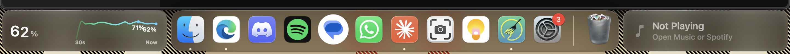
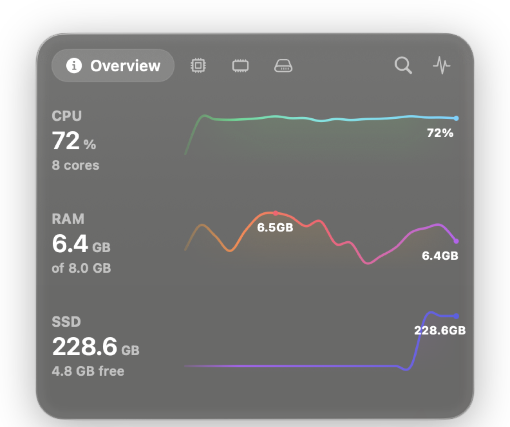
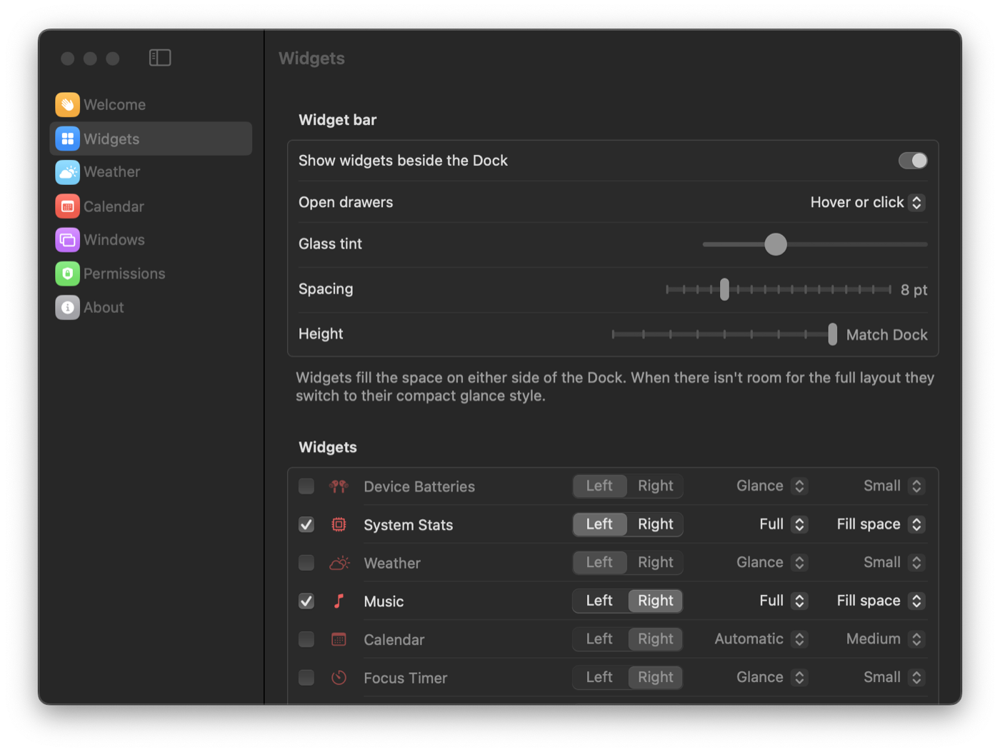
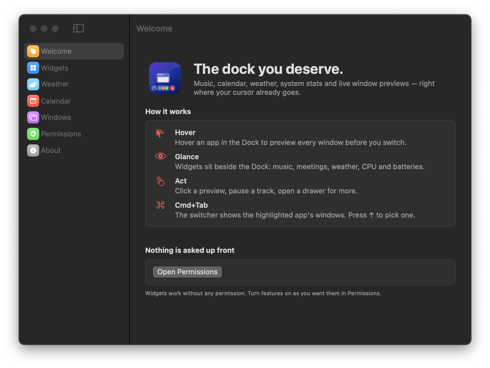

<div align="center">

# Harbor

**Everything you need, moored to your Dock.**

Glass widgets, Dock window previews and a better ⌘Tab, built for the Mac you already have.

A native macOS app for Intel and Apple silicon Macs running **macOS 14 Sonoma or later**.


<br>



<sub>System Stats on the left of the Dock, Music on the right. Both sit in the empty space beside the Dock.</sub>

</div>

---

## Contents

- [What it does](#what-it-does)
- [Widgets](#widgets)
- [Install](#install)
- [Getting started](#getting-started)
- [Permissions](#permissions)
- [Tips](#tips)
- [Building from source](#building-from-source)
- [License](#license)

---

## What it does

| | |
| --- | --- |
| 🧊 **Widgets beside the Dock** | Liquid-glass widgets fill the empty space on either side of your Dock. Click or hover one to open a drawer with more detail. |
| 🪟 **Dock window previews** | Hover an app in the Dock to see live thumbnails of every window, including minimized ones and windows on other Spaces. Click to jump to it. |
| ⌘ **A better ⌘Tab** | See each app's windows as you switch. Pick the exact window you want with the arrow keys. |
| 📐 **Window tiling** *(optional)* | Snap the front window to halves, thirds and quarters with a keyboard shortcut. |

Everything moves with the Dock: widgets slide aside when the Dock magnifies or a window minimizes, follow auto-hide, and stay off full-screen apps.

---

## Widgets

| Widget | What you get |
| --- | --- |
| 🎵 **Music** | Now playing for Apple Music, Spotify and browsers. Play controls, **synced lyrics**, Up Next, playlists, search and recently played. Spotify works on free accounts. |
| 📅 **Calendar** | Your next event with a countdown, a one-click **Join** button for video calls, a 5-minute reminder and today's schedule. |
| ☀️ **Weather** | Current conditions plus hourly and 7-day forecasts, for where you are or any city you save. |
| 📊 **System Stats** | CPU, memory, storage, GPU, disk and network with live graphs. Includes top processes and a large-file finder. |
| 🔋 **Batteries** | Your Mac, Magic Mouse, Keyboard, Trackpad and AirPods (left, right and case). |
| ⏱️ **Focus Timer** | A Pomodoro timer that keeps counting through sleep and restarts. *Off by default.* |
| 🗂️ **Smart Stack** | Several widgets in one slot. Scroll to flip, or let it show what matters right now. *Off by default.* |

<table>
<tr>
<td width="42%" valign="top">

<p align="center"><sub><b>Drawers.</b> Hover or click a widget for more. Here, System Stats with live graphs.</sub></p>
</td>
<td width="58%" valign="top">

<p align="center"><sub><b>Make them yours.</b> Pick each widget's side, layout and size.</sub></p>
</td>
</tr>
</table>

Make them yours in **Settings → Widgets**: choose which widgets show, which side they sit on, their order, size and layout, and whether drawers open on hover, on click or never.

---

## Install

1. Download **Harbor-1.0.0.dmg** from the [latest release](https://github.com/vivaanseth/harbor/releases/latest) and open it.
2. Drag **Harbor** into your **Applications** folder.
3. The first time, **right-click the app → Open**, then click **Open**. (On macOS 15 or later, open it once, then click **Open Anyway** in **System Settings → Privacy & Security**.) A welcome window walks you through the rest.

> [!IMPORTANT]
> Releases aren't notarized by Apple, so macOS asks you to confirm the first time you open the app. After that it opens normally.

<p align="center">

</p>

> [!NOTE]
> Harbor runs from the menu bar (look for the Dock icon). It has no Dock icon of its own.

---

## Getting started

1. **Open Harbor.** Widgets appear beside your Dock right away.
2. **Turn on the features you want** in **Settings → Permissions**. Nothing is requested until you ask for it.
3. **Hover or click a widget** to open its drawer.
4. **Hover an app in the Dock** to see its windows, or press **⌘Tab** to try the switcher.

### ⌘Tab shortcuts

| Key | Action |
| --- | --- |
| `↑` | Move to the window row |
| `←` `→` | Choose a window |
| Release `⌘` | Switch |
| `Q` / `H` / `W` | Quit app / hide app / close window |
| `Esc` | Cancel |

### Tiling shortcuts *(when turned on)*

| Key | Action |
| --- | --- |
| `⌃⌥←` / `⌃⌥→` | Half, then third, then quarter of the screen |
| `⌃⌥↑` | Fill the screen |
| `⌃⌥↓` | Center the window |

---

## Permissions

Each permission is optional and only unlocks the feature next to it.

| Permission | Unlocks |
| --- | --- |
| **Accessibility** | Dock previews, ⌘Tab switcher, Spotify's Up Next, and widgets that move instantly with the Dock |
| **Screen Recording** | Window thumbnails |
| **Calendar** | Calendar widget |
| **Location** | Weather where you are (otherwise your time zone's city or a saved city) |
| **Automation** | Controlling Apple Music and Spotify |
| **Notifications** | Calendar reminders |

> [!TIP]
> If Accessibility is switched on in System Settings but Harbor still asks for it, choose **Turn On Accessibility…** from the menu bar icon, then **Reset and Turn On**. This clears an old entry left by a previous build.

---

## Tips

- **Widgets look cramped?** Make the Dock a little smaller in **System Settings → Desktop & Dock**. Widgets switch to compact tiles when space is tight and move to the other side when they don't fit.
- **Widgets only appear with the Dock at the bottom** of the screen.
- **The built-in ⌘Tab comes back** whenever Harbor quits, even after a crash.
- **Spotify without Premium:** Up Next and "playing from" are read from Spotify's Now Playing panel, so keep that panel open. To add a playlist, copy its link in Spotify (Share → Copy link) and choose **Add Copied Link** in the Music drawer.

---

## Building from source

**Requirements:** Xcode 15 or later (or the Command Line Tools with Swift 5.9+).

```bash
./build.sh                 # Release build for Intel → build/Harbor.app
UNIVERSAL=1 ./build.sh     # Intel + Apple silicon
./build.sh --install       # Also copy the app to /Applications
CONFIG=debug ./build.sh    # Faster debug build
```

### Keeping permissions between builds

macOS ties permissions to an app's signature. Run `scripts/setup-signing.sh` once to create a local signing identity in `.signing/`. Every build is then signed the same way and macOS keeps its permissions. Without it, builds are ad-hoc signed and permissions must be granted again after each rebuild.

> [!WARNING]
> `.signing/` contains a private key. It is excluded from Git. Never commit or share it.

### Project layout

```
Sources/Harbor/
├── App/          App lifecycle, menu bar, permissions
├── Dock/         Dock tracking and motion
├── Previews/     Dock window previews
├── Switcher/     ⌘Tab switcher
├── Widgets/      Widget bar and each widget
├── Settings/     Settings window
└── UI/           Glass, motion, theme and shared components
```

---

## License

Harbor is free for personal and other noncommercial use under the [PolyForm Noncommercial License 1.0.0](LICENSE.md). Commercial use requires permission.

---

<div align="center">
<sub>Made by <a href="https://github.com/vivaanseth">@vivaanseth</a> · <a href="LICENSE.md">PolyForm Noncommercial 1.0.0</a></sub>
</div>
